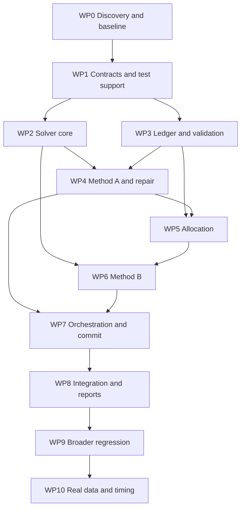

# M5 Developer Handover

Status: implementation handover for Milestone 5 (large lanes), Revision 9. Date: 17 November 2026.
Revision 9 uses `M5_Edge_Cases_and_Tests_v12.md` (304 named tests, 557 variants, 24 invariants, 48 EC items, 10 CL rules); the M4 baseline is commit f9d9945 (Saif's fixes for Tom's 12 Nov review of e6dbb0f,
m4Fix2Verification.txt; previous baselines e51d9c4 and 7cef94e); Tom's follow-up answers are applied (architecture Section 15). Main changes for the
developer:
- No minimum-load acceptance inside M5 (the customer checks it at export). The predicate stays an optional,
  OFF policy with synthetic tests.
- Every truck gets a fullness label: FULL by 98% weight, by rear inches (default 14 in, user setting) or
  floor-limited; plus a report bucket. Labels never withhold a truck.
- Careful method whenever the quick result is above a valid minimum; allowance = seconds per load (user
  setting) x reserved trucks.
- Can-go goods fill M5 lane-dates after required goods (needs M4 change P10).
- Past-due order: AgeFirst run-wide stays current at f9d9945. P9 is deferred until agreed; its integration override variants are outside current milestone applicability and never counted as PASS. Synthetic direct-context isolation remains runnable.
- Floor search returns Fits/DoesNotFit/Undecided under per-search and shared route-state limits. A validated witness proves fit; a negative heuristic or exhausted search cannot exclude an improving load or prove optimality (architecture Section 5.6/Section 8.1; R-5a/b, R-8, X-PAT-18, U-PF-09).
- The effective unit-load cap counts normalized component unit loads times whole-atom copies, never stacks. It reaches packing classes, columns, actual slots, copies, repair, validation and caches (ED-20; R-9, X-PAT-16/17, X-STATE-11, X-CG-21). Current production uses M4's validated global cap for every slot; heterogeneous direct tests do not require a new production feed.
- Comparator: confirmed urgency/service precedence and no fewer-trucks preference. Equal-service ties use ED-21
  (Tom, 14 Nov; OPEN-COMP resolved): shipped unit loads per group in a group order rotated by lane and ship
  date, then canonical records. Rotation r = (laneKey mod g + dayNumber mod g) mod g, laneKey = 32-bit FNV-1a
  of "origin|destination|mode" (tests v11 Section 0.8). No input order, truck count, fill, rear space or
  weight in the tie, and it never overrides urgency, eligibility, hard limits or reservations (X-RES-13).
- C9 (Tom, 14 Nov): refuse a lane-date whose reserved trucks have different trailers; do not guess. A truck-type
  mix from an availability list is out of scope for M5. One alternate trailer type for a whole run is in scope:
  U-DA-07 tests a 40 ft high-cube container (473.70 x 92.52 x 106.22 in inside); a type without payload or
  unit-load limit is a configuration error, never a silent 53F default.
- R-1a, R-1b and R-5a: Tom's exact inputs arrived on 16 Nov. Commit them unchanged under
  `tests/fixtures/tomReview/m5ExactInputs/` and check the SHA-256 values in tests v11 Section 40. R-1b uses a
  100 x 100 in floor.
Read first: `m5ModularArchitecture.md` (design), `m5TestTraceability.md` (test map), `M5_Edge_Cases_and_Tests_v12.md`
(requirements). The manifest `m5TestManifest.json` is the machine-readable form of the test map.

Commit check (open before WP0). Saif's reply to Tom names the delivered fix as commit d028f24 on
PR #3, on top of e6dbb0f, with 1,154 test cases on macOS. The verified tree is f9d9945, with 1,165 cases.
Neither d028f24 nor e6dbb0f was in the local clone used for m4Fix2Verification.txt. Saif confirms which
commit is the delivery and how it relates to f9d9945 (only Saif runs git commands that change repository
state). If the accepted commit differs from f9d9945, apply WP0 step 8 before any M5 baseline comparison.

Repository claims are REPORTED from the supplied handover's references to tool runs at `7cef94e`,
`e51d9c4` and `f9d9945` (Tom's e6dbb0f was not available in the last run; e51d9c4 stood in for it). The attached bundle contains neither the source repository nor those original verification reports.
This review performed document consistency checks only. WP0 opens the actual code/reports, records their
identity and distinguishes direct verification from a quoted report; do not mark an item VERIFIED merely
because this handover repeats it.

## Coming from tests v7 (291 tests)

If your test registry still follows v7, these are the changes to pick up. The manifest is the full list.

| Version | New tests | Changed in place |
|---|---|---|
| v8 | R-8 (Tom's eleven stacks; probe must count trials that reach selection), R-9 (unit-load cap from config, 64 default) | R-5a now uses Tom's e6dbb0f files (fourteen stacks, nine variants, 23 unit loads); do not ask Tom for it again. R-5b adds the 11-16 stack region and an exact row-grouping oracle. R-7 integration variants deferred |
| v9 | X-PAT-16, X-PAT-17, X-PAT-18, X-STATE-11, X-CG-21, U-PF-09 (Section 36) | Floor search returns Fits/DoesNotFit/Undecided; caps count component unit loads; shared floor-state budget. RD-13 adds two Aug5 lane variants; X-RUN-09 adds two gate variants |
| v10 | X-RES-13 (Section 38) | CL-02 tie rule is ED-21 |
| v11 | U-DA-07 (Section 40) | R-1a/R-1b runnable with Tom's files; ED-21 rotates by lane and date; X-RES-13 adds acrossLanes; X-META-06 allows a different tie winner |

Reporting progress: a test or variant counts as PASS only when its evidence record exists for the current
commit (traceability Section 11): test ID, variant, commit, fixture identity and result. Report counts per
variant from that record, against the current manifest (301 tests, 522 variants), and keep NOT_RUN and
BLOCKED separate.

## M5 delivery to Tom (what his engineer asked for on 16 Nov)

Tom's engineer will only accept results he can check. An M5 delivery contains:

1. The M5 branch or pull request, with the exact commit.
2. Test output for every variant in the current manifest (301 tests), as evidence records: test ID,
   variant, commit, fixture identity (with SHA-256 for Tom's files) and result. NOT_RUN and BLOCKED are
   listed separately, never counted as passes.
3. R-1a, R-1b and R-5a enabled with Tom's 16 Nov files, plus the output of his `run_requested_cases.cpp`
   (expected 25 / 2 / 23).
4. The OR-Library cases (PUB-01..03: 48, 49 and 46 bins) with the independent check.
5. The 38-truck reference (7 and 8 Aug, 21 and 20 reserved) with elapsed time per truck, group,
   lane-date and total, against the allowance seconds per load x reserved trucks.
6. The build log for MSVC and GCC/Clang with the flags used, and any warning exception named.

Do not send pass counts without that output.

## 1. Rules for every package

- C++17 only. camelCase for new names; namespace `ob::m5`. Plain ASCII in all output. No AI attribution in code,
  commits or reports.
- Clean builds: MSVC x64 VS2022 Release `/W4 /WX /utf-8`; GCC and Clang `-Wall -Wextra -Wpedantic -Werror`.
  The GCC 16.1 libstdc++ regex warning (RK-6) remains unresolved. The REPORTED f9d9945 run used command-line-only
  `-Wno-error=array-bounds`; record that exception separately, never as a clean strict-warning result. Do not
  weaken tracked flags or silently treat the gate as closed.
- Saif owns the repository: work on a branch, open a pull request, do not merge or push to `main`. The client
  repository receives completed milestones only.
- Confidential fixtures are copied in by hand; a run with fixtures missing proves little and is never a PASS.
- New tests use unique temp paths (lesson from `tests/params`, P4) and the M5 test ID in the doctest case name:
  `TEST_CASE("X-REB-09 fifty: rebalance 25 + 25" * doctest::test_suite("m5"))`.
- Every executed variant writes an evidence record (traceability Section 11). Never invent hashes, timings or
  results. A created test is NOT_RUN until it runs.
- Synthetic fixture values live only under `tests/m5/support/`. Production code never contains them.

## 2. Commands

REPORTED working commands (from msvcCleanRun.txt, m5MissingDataCheck.txt and m4BaselineForM5.txt; the baseline used
a clean folder `build-msvc-m4base`: build 260.6 s, quick ctest 317.6 s, m4Benchmark 2,033.8 s, all on battery):

```bat
cmake -S . -B build-msvc -G "Visual Studio 17 2022" -A x64
cmake --build build-msvc --config Release --parallel -- /nodeReuse:false
ctest --test-dir build-msvc -C Release --output-on-failure -E m4Benchmark
ctest --test-dir build-msvc -C Release -V > build-msvc\ctestFull.txt 2>&1
```

Run ctest from the repository root (fixtures are found from there). `build*/` is ignored by `.gitignore` (REPORTED).

PROPOSED additions (WP1 adds them to CMake; verify names against the existing `add_test` calls):

```bat
REM fast M5 synthetic suite inside ob_tests
build-msvc\Release\ob_tests.exe -ts=m5
REM ctest entries
ctest --test-dir build-msvc -C Release -R m5Core --output-on-failure
ctest --test-dir build-msvc -C Release -R m5RealData --output-on-failure
ctest --test-dir build-msvc -C Release -R m5Benchmark -V
```

`m5Core` = `ob_tests -ts=m5` (synthetic, no confidential fixtures except where a case says so).
`m5RealData` = real August fixtures (RD, U-PB-12, X-E2E-01). `m5Benchmark` = performance runs, isolated, serial.
GCC/Clang: `cmake -S . -B build-gcc -DCMAKE_BUILD_TYPE=Release && cmake --build build-gcc -j && ctest --test-dir build-gcc -R m5Core`.

## 3. Package overview and order



Report rendering can start after WP1; scalar generated tests can start after WP2. Their integration
and evidence gates still follow the stated package dependencies.

Suggested ownership for two developers once WP1 interfaces are merged:

| Developer | Packages | Why |
|---|---|---|
| Dev A (algorithms) | WP2, WP4, WP5, WP6 | Solver, methods and allocation are tightly coupled |
| Dev B (platform) | WP0, WP1 harness/fixtures/oracles, WP3, WP8 report renderer, WP7 budget/commit, WP9 generators | Clean seams; can proceed in parallel |
| Both | WP7 integration of methods, WP10 | Joint review of selection and real-data evidence |

Mahib reviews all pull requests as architect; Saif reviews and merges.

## WP0 - Discovery, baseline reproduction, M4 prerequisites

Purpose: Commit the f9d9945 baseline, turn the baseline reports into the repository inventory, and land the remaining M4 prerequisites (P2, P3, P4, P8; P9 deferred). P1, P5, P6 and P7 are DONE (m4BaselineForM5.txt at 7cef94e, m4FixVerification.txt at e51d9c4, m4Fix2Verification.txt at f9d9945). P9 is deferred (agreed milestone pending). P10 (pull-forward into M5 lane-dates) is done in WP8.

Suggested owner: Dev B.

Files: docs/m5/m5RepoInventory.md (new); include/truckCheck.hpp, src/truckCheck/truckCheck.cpp (extracted); selector.hpp/.cpp (gathering function P3); tests/params (P4).

Needs first: None.

Steps:

1. Commit (via Saif) the baseline files under `docs/m5/baselines/f9d9945/`: `m4Fix2Verification.txt`, `verify/m4LaneDates_Aug4/5/6.csv`, `verify/octoberFixtures.txt`, the R-5b failure files (`failures_old/` from 7cef94e, `failures_e51d9c4/`, `failures/` from f9d9945), Tom's e6dbb0f review files under `tests/fixtures/tomReview/e6dbb0f/` (synthetic), and from the 7cef94e baseline `m5Handover_Aug5_0807.csv` and `inputHashes.txt` (hand-over unchanged). Record Saif's decision on keeping confidential client values out of the client repository.
2. Open the actual baseline reports and current source. Create `docs/m5/m5RepoInventory.md` from the baseline facts/differences and B16-B30; record path/symbol, report commit, current commit and verification method for every row. Mark VERIFIED only after its stated check succeeds; retain REPORTED/UNVERIFIED where evidence is absent.
3. P9 (M4): DEFERRED. AgeFirst run-wide stays current; add the per-lane `pastDueOrder` override (default AgeFirst) only after Tom agrees it and an M4 milestone is set; then test that switching one lane changes only that lane (R-7 M4 variant); with no overrides the twelve fingerprints of f9d9945 must not move.
4. P2: extract the row checks (`setRowChecks`, `truckLimits`, `arrange`, `floorFits`, `keepsMethodLoad`) into `include/truckCheck.hpp` / `src/truckCheck/truckCheck.cpp`; preserve typed Fits/DoesNotFit/Undecided, safe growth-prune semantics, per-search and shared route-state ownership. Verify the M4 route/group scope before binding M5 contexts; full `ob_tests` and f9d9945 fingerprints unchanged.
5. P3: add `collectEscalatedLaneDates()` and the declared normalized source-universe view, including unoffered date/order-excluded rows and version identity. The baseline required-demand unit test gives 3 routes, 747 stacks, 763 unit loads, 21 reserved; can-go additions are counted separately. Never infer NoGoodsRemain from the eligible queue alone.
6. P4: make `tests/params` temp files unique (or add a serial-only guard and document it).
7. P8: U-PF-04 passes; flip the U-RT-08 asserts in WP8 once the threshold benchmark records T.
8. When Tom accepts M4 at a commit other than f9d9945, rerun the verification prompt and replace the baseline folder; diff fingerprints.

Validating tests (3): U-RT-08, U-PF-04, RD-02.

Done when: Baseline and inventory committed; P2, P3, P4 merged (P9 when its milestone is agreed) with ob_tests unchanged except their new tests; f9d9945 fingerprints identical with no per-lane overrides; every architecture Section 2.2 item marked VERIFIED or CHANGED.

Pending dependencies: Tom's acceptance of the M4 baseline; commit of Tom's R-1a/R-1b/R-5a files with checksums. Obtain/identify the REPORTED R-5a/R-8/R-9 raw package before claiming it reproduced. P9 is a separately deferred milestone; C9 concerns a future per-truck input feed, not the current global-cap or direct-seam tests.

Rerun when dependencies change: If the head commit changes before WP1, repeat P1 and the inventory diff.

## WP1 - Contracts, policy and config, fixtures, test seams, oracles

Purpose: Freeze the M5 public headers and give every later package its fixtures, seams and independent oracles.

Suggested owner: Dev B (types with Dev A review).

Files: include/m5Types.hpp, m5Policy.hpp, m5Ledger.hpp (types), m5Budget.hpp (types), largeLanePlanner.hpp; src/m5Policy/; tests/m5/support/{m5Fixtures.hpp, fixtures/*.json, oracles/m5BruteForcePacker.*, m5AllocationEnumerator.*, m5LayoutChecker.*, m5PackingChecker.*, m5InvariantChecker.*, m5EvidenceWriter.*, fakeClock.hpp}; CMake test entries m5Core/m5RealData/m5Benchmark.

Needs first: WP0 inventory (type names).

Steps:

1. Write the headers of architecture Section 5 with the verified M4 type names; compile with no implementation (stubs return NotImplemented outcomes).
2. Implement m5Policy: optional acceptance (absent = OFF; malformed present policy = error), `FullnessRule` (98%, configurable rear default 14), `secondsPerLoad`, current run-wide M4 past-due order and can-go flag. Keep `orderByLane` synthetic/future-only while P9 is deferred and reject unsupported production overrides. Validate routing, block/gap settings, positive integer unit-load caps and both floor-state limits before planning; exact optional acceptance comparisons remain unchanged.
3. Freeze the authoritative normalized numeric representation and supported precision; implement checked decimal/rational comparison and unit conversion (ED-ARITH). Keep M4 conservative physical-search grains separate. Add boundary/overflow oracles that do not reuse the production converter; do not round optional acceptance or fullness thresholds to 0.001.
4. Implement fixture builders FX-30, FX-ROUTE, FX-GAP, FX-CLOCK, FX-PRIORITY, FX-COMMIT, FX-COUNT, FX-BLOCK, FX-FULL, FX-CANGO and the local fixtures listed in traceability Section 4.
5. Implement independent oracles with declared scopes: BRUTE for scalar <=10-item cases; LAYOUT-ENUM for the R-5 and R-8 supported-layout physical probes (6-14 stacks by an explicit finite layout search; 11-20 stacks by the exact row-grouping search over every grouping into candidate rows, by dynamic programming over subsets or over counts for few footprints); R-1a uses the independently supplied expected witness plus layout/conservation checks, not an unsupported 40-item exhaustive claim; ENUM-ALLOC for <=3-slot/<=60-unit allocation fixtures; CLASSCOUNT for analytical whole-truck class counts such as X-RUN-05 (2 P0 plus 19 P11 in 21 slots). Add the multiset generator, independent layout/packing/conservation checkers and evidence writer. Do not send a 14-stack physical problem to the scalar <=10 oracle or a 21-slot fixture to the <=3-slot enumerator. Any wider exact mode declares its limit and independent reference method.
6. Register test identities/required variants from the current manifest. Unimplemented placeholders remain NOT_RUN/BLOCKED and cannot produce PASS, even if the surrounding doctest process exits zero. Use an explicit development subset when scaffolding is incomplete.
7. Add the manifest/evidence acceptance gate (X-RUN-09): every required ID/variant is uniquely registered and has one current valid result; missing implementation, missing variant, duplicate/conflicting result, stale requirements/input/profile/build identity, NOT_RUN, BLOCKED or a skip cannot yield an acceptance pass. Verify current manifest coverage rather than hard-coding an obsolete count.

Validating tests (21): U-RT-04, U-RT-05, U-AC-01, U-AC-04, U-RB-03, U-FF-04, U-RS-05, U-PF-05, U-FL-03, X-ROUTE-06, X-RES-05, X-DATA-03, X-DATA-04, X-DATA-05, X-DATA-10, X-DATA-12, X-DATA-13, X-DATA-14, X-REPORT-04, U-AC-09, U-PF-06.

Done when: Headers merged and reviewed; WP1 implemented tests pass; every manifest ID/variant is registered without claiming placeholder passes; the acceptance gate rejects incomplete evidence; independent oracles pass scope-appropriate self-checks. Architecture readiness is distinct from later application test execution.

Pending dependencies: CL-01 zero/range domain for the optional policy (engineering, record before U-AC-04 zeroAndRange runs).

Rerun when dependencies change: If WP0 changes type names, update headers before WP2/WP3 start.

## WP2 - Scalar optimization core: bounds, exact cases, integer completion, acceptance adapter

Purpose: Extend the existing columnGeneration and add m5Solver so that every capacity-only exact case and the published cases reach their known optimum with honest evidence.

Suggested owner: Dev A.

Files: existing patternPacker/columnGeneration files (extend); include/m5Solver.hpp, src/m5Solver/m5Solver.cpp; tests/m5/solver/*.

Needs first: WP1 types; WP0 notes on columnGeneration.

Steps:

1. Read columnGeneration; record LP method, pricing exactness, integer step (architecture 8.3).
2. Add evidence record, column validator, duplicate detection and exact pricing entry. Cap-constrained item resources include checked component unit loads per whole atom; bin types include actual effective caps. Model/column keys include those resources. No fractional atom completion or late cap trimming may keep a stale optimum claim.
3. Implement L1/Farley bounds with model/objective/relaxation identities. A unit-load relaxation may be weak: X-CG-21 has seven indivisible two-unit-load atoms, cap 5, bound ceil(14/5)=3 and exact optimum 4. Preserve the valid bound without inventing a feasible three-truck packing.
4. Implement FFD adapter (binPacker) exposing F and witness; EscalationPolicy interface with FX-GAP implementation.
5. Implement bounded integer completion (residual re-pricing, no-progress detection, exact solving within declared limits and a bounded supported fallback). Preserve the prior checked incumbent on stop; never recurse indefinitely on unchanged residual demand or use unbounded exhaustive enumeration for oversized residuals.
6. Implement the acceptance-adapter model (equality demand, two constrained knapsacks, enumeration certificate) and partial-service objective.
7. Commit binpack1.txt to tests/m5/data/orlib/ with its recorded SHA-256 (after Saif agrees on the location); verify headers 48/49/46.

Validating tests (32): ACC-1, U-CG-01, U-CG-02, U-CG-03, U-CG-04, U-CG-05, U-CG-06, U-CG-07, U-CG-08, X-CG-01, X-CG-02, X-CG-03, X-CG-04, X-CG-05, X-CG-06, X-CG-07, X-CG-08, X-CG-09, X-CG-10, X-CG-11, X-CG-12, X-CG-13, X-CG-14, X-CG-16, X-CG-17, X-CG-18, X-CG-19, PUB-01, PUB-02, PUB-03, X-CG-21, X-CG-22.

Done when: All WP2 tests PASS on MSVC, GCC, Clang; X-CG-18 shows LP 2.7 converged, restricted integer 4, incumbent 3, bound 3, ProvenOptimal; X-CG-19 ProvenInfeasible plus partial variant; PUB-01..03 exact with independent check; ACC-1 evidence recorded.

Pending dependencies: binpack1.txt location (Saif). Q6 is answered; FX-GAP is the production rule.

Rerun when dependencies change: If the escalation trigger is refined from measurements, rerun U-FF-*, X-CG-17, U-RP-03, ACC-3.

## WP3 - Ledger, eligibility, reservations, physical adapter, final validator

Purpose: Make every candidate checkable: identity and conservation, component eligibility, shared pool, physical witnesses and the conjunctive final validator.

Suggested owner: Dev B.

Files: src/m5Ledger/, src/m5Physical/, src/m5Validation/; tests/m5/validation/*, tests/m5/integration/testM5HandoverData.cpp.

Needs first: WP1; WP0 P2 (truckCheck extraction), P5, P6.

Steps:

1. buildSnapshot from M5LaneDateInput (P3 output) without renormalizing quantities; duplicate-line detection.
2. componentEligibility using M4 date helpers and daysPulledForwardAllowed(); eligibility memo keyed by date and rules.
3. ReservationPool and CandidateClaims with marks; QuantityLedger reconcile. Current real slots inherit the validated global `selection.maxUnitLoadsPerTruck`; direct seams may supply heterogeneous resolved caps. Preserve slot/profile versions and signatures; C9 blocks only a future unsupported production override feed.
4. Implement the Section 6.4 typed search adapter, cap-aware `PackingClass`, `bestSingleClassLoad` result with separate witness/maximum proof, and GeometryCache. Every search borrows the owned route-state context and parent deadline; no null-budget bypass. Validate component unit-load sums and whole copies on the actual slot. Keep pure supplied-witness coverage/geometry/cap validation separate from arrangement search and conservative grains; U-FL-06/10 retain exact coordinates without compaction. X-PAT-16/18 verify composition and tri-state/witness distinctions; U-PF-09 verifies search limits and Unknown cache handling.
5. validateFinal with mandatory dispatch sections/findings and revision checks; optional acceptance only when enabled. A separate evaluateFullness diagnostic uses the final RemainingDemandView and remaining budget. Incomplete no-fit diagnostics never flip already completed hard validation to failed/incomplete (U-FL-09).
6. Implement ED-FULL (architecture 9.7): final weight/rear reasons independently; floor-limited only with a nonempty otherwise-eligible same-group probe set and proved no-fit in the declared M4 layout scope. Incomplete probing is Unknown; if no weight/rear reason establishes FULL, render Undetermined, not conclusive NOT FULL. U-FL-07 exercises legal stacking through M2 rather than re-stacking M5 rigid atoms. Use final reconciled remaining-demand buckets and invalidate labels when that context changes; labels never withhold cargo.
7. Wire m5InvariantChecker into every WP3 test.

Validating tests (49): R-3a, R-3b, R-8, R-9, U-PB-04, U-PB-05, U-PB-06, U-PB-07, U-AC-06, U-RS-01, U-RS-08, U-RS-09, U-RS-10, U-RS-11, U-FL-01, U-FL-02, U-FL-04, X-PAT-06, X-PAT-07, X-PAT-11, X-PAT-12, X-PAT-13, X-PAT-14, X-PAT-15, X-DATE-01, X-DATE-02, X-DATE-03, X-DATE-04, X-DATE-05, X-DATE-07, X-DATE-09, X-DATE-10, X-DATE-11, X-DATE-12, X-DATA-01, X-DATA-02, X-DATA-07, X-DATA-08, X-DATA-09, X-DATA-11, U-FL-06, U-FL-07, U-FL-08, U-FL-09, U-FL-10, X-PAT-16, X-STATE-11, X-PAT-18, X-PAT-19.

Done when: Every currently runnable WP3 variant PASS; variants awaiting their declared runnableAfter WP4/WP5 or integration package remain NOT_RUN with that dependency. U-AC-06 all seven variants PASS. A pure valid witness remains checkable when grouping states are exhausted; incomplete search cannot become a negative proof.

Pending dependencies: none customer-side; C9 capability gap for U-DA-05 input variant.

Rerun when dependencies change: If Tom changes the 14 in default, rerun U-FL-01..04 and RD-10/12.

## WP4 - Method A, residual packing, repair and rebalance

Purpose: Produce finally valid supplies per group using repeated patterns, residual packing and bounded repair; optional acceptance is applied only when explicitly enabled.

Suggested owner: Dev A.

Files: src/m5PatternPlanner/, src/m5Repair/ (CandidateEditor, rebalanceForAcceptance); tests/m5/methodA/*.

Needs first: WP2, WP3.

Steps:

1. Implement PatternPlanner::supplyForGroup per architecture 7.4 with count-based copies/source draws and packing classes refined by unit loads per atom. Enforce each actual slot's cap during generation, repetition and residual packing; preserve Unknown/maximum-proof status and the shared floor ledger. Acceptance remains OFF for the customer: no x/y read, acceptance repair or AcceptanceWithheld reason. Underfilled valid trucks remain eligible; fullness is advisory.
2. Residual packing through the packer layer only (no selector calls); assert no recursion in a test.
3. CandidateEditor invalidates validation/proof/comparison and affected fullness labels. Repair uses a copy, the shared wall/floor budgets and pure final donor/recipient checks including exact component unit loads on the actual slot. No move splits an atom, exceeds a cap, or treats Unknown as feasible. Failure/stop retains only a fully checked incumbent or NoValidatedCandidate. X-PAT-17 covers A/B/copies/repair; optional-policy repair stays guarded by acceptance enabled.
4. Exact-mode supplies through m5Solver for ExactLimits instances.

Validating tests (39): R-1a, R-1b, R-1c, R-5a, U-PB-01, U-PB-02, U-PB-03, U-PB-08, U-PB-09, U-PB-10, U-PB-11, U-RM-01, U-RM-02, U-RM-03, U-RM-04, U-AC-02, U-AC-03, U-AC-05, U-AC-07, X-PAT-01, X-PAT-02, X-PAT-03, X-PAT-04, X-PAT-05, X-PAT-10, X-REB-01, X-REB-02, X-REB-03, X-REB-04, X-REB-05, X-REB-06, X-REB-08, X-REB-09, X-DATE-06, X-E2E-03, X-E2E-04, X-E2E-09, X-PAT-17, X-REB-10.

Done when: Available WP4 tests PASS, including R-1a/b on Tom's 16 Nov files (R-5a, R-8 and R-9 run on his e6dbb0f files), and runnableAfter-WP5 items remain NOT_RUN until integration; U-AC-07 both variants PASS; X-REB-09 fifty and fortyNine PASS once WP5 lands.

Pending dependencies: Saif's commit of Tom's 16 Nov files (R-1a, R-1b, R-5a) and e6dbb0f files (R-8, R-9), with checksums.

Rerun when dependencies change: When Tom's files are committed or replaced: R-1a/b, R-5a, R-8, R-9.

## WP5 - Allocation master and comparator

Purpose: Choose complete allocations across groups and slots using confirmed service/date precedence and the explicit comparator, with optional acceptance only when enabled; input order never allocates scarce resources.

Suggested owner: Dev A.

Files: src/m5Allocation/; tests/m5/allocation/*, tests/m5/e2e/ (X-E2E-02/07).

Needs first: WP3 (pool, keys), WP4 supplies (for end-to-end cases), WP0 P7.

Steps:

1. Implement the complete AllocationKey: common urgency domain `(rankDate, priority, originalShipDate)`, component counts, final rear-space/weight metrics, nonempty truck count and canonical records. Implement the ED-21 equal-service tie rule (T1 rotated group order, T2 canonical records); OPEN-COMP is resolved. Do not use an invented sum/average or synthetic fewer-trucks tie rule. Keep FX-PRIORITY/R-4/X-RUN-13 comparators explicit.
2. Implement allocate(): exact small comparison and DP over groups/slot capabilities with a justified extension-preserving dominance rule. Only urgency counts are automatically additive; canonical records require structured merge/order. Retain nondominated alternatives where aggregation is not extension preserving. A no-scarcity shortcut must not bypass required-before-can-go service, validation, or the declared comparison scope.
3. Order independence: canonical traversal; X-E2E-07 permuted variant.

Validating tests (24): R-2, R-4a, R-4b, R-4c, R-6, U-RS-03, U-RS-04, U-RS-06, U-RS-07, X-REB-07, X-RES-01, X-RES-02, X-RES-03, X-RES-04, X-RES-06, X-RES-07, X-RES-08, X-RES-09, X-RES-12, X-DATE-08, X-STATE-08, X-E2E-02, X-E2E-07, X-RES-13.

Done when: WP5 tests PASS against the independent allocation enumerator; X-RES-12 both variants PASS at the physical/allocation seam.

Pending dependencies: P9 integration override variants are deferred outside this milestone, not a WP5 prerequisite; direct-context R-7 isolation remains runnable. OPEN-COMP is resolved as ED-21 (X-RES-13). Check R-6 against the actual corrected M4 `dealByBestTruck` result; single-truck greedy behavior alone does not prove a complete multi-truck allocation.

Rerun when dependencies change: If ED-02 changes: rerun R-2, R-4, U-RS-03/04/06/07, X-RES-*, X-STATE-07/08, X-E2E-02/07, U-RB-05.

## WP6 - Method B rolling blocks

Purpose: Implement block planning that bounds search size without consuming the shared pool.

Suggested owner: Dev A.

Files: src/m5BlockPlanner/; tests/m5/methodB/*.

Needs first: WP2, WP3, WP5.

Steps:

1. Implement BlockPlanner::supplyForGroup per architecture 7.5 with configurable block size; never pad the final block. Guard optional acceptance; preserve required-before-can-go service across the entire lane-date, including competing groups; detect unchanged requeued state so a failed atom cannot loop indefinitely.
2. Stop cleanly when no truck can be built (X-RUN-06).

Validating tests (9): U-RB-01, U-RB-02, X-BLK-01, X-BLK-02, X-BLK-03, X-BLK-04, X-BLK-05, X-RUN-05, X-RUN-06.

Done when: WP6 tests PASS; X-RUN-05 PASS with the independent CLASSCOUNT oracle (2 P0 and 19 P11 trucks), not the <=3-slot allocation enumerator.

Pending dependencies: None.

Rerun when dependencies change: None for customer answers.

## WP7 - Orchestrator: budget, scheduling, selection, commitment, retry, caches

Purpose: Run a lane-date end to end with a declared budget, isolated candidates, honest outcomes and safe commitment.

Suggested owner: Dev A + Dev B.

Files: src/m5Orchestrator/, include/m5Budget.hpp impl, src/m5Commit/; tests/m5/orchestration/*.

Needs first: WP4, WP5, WP6.

Steps:

1. Budget/BudgetSlice use the monotonic allowance = secondsPerLoad x frozen reserved trucks, with checked conversion/arithmetic. Own one floor route-state ledger per declared route scope for the invocation; per-search caps debit it across A/B, candidates, blocks, repair and probes. Never reset it or pass a null context. U-PF-09 uses deterministic states (3 per search, 5 per route) alongside the parent deadline. Final validation/selection remain within that wall/work allowance; retain a fully checked incumbent on stop and report actual overruns. Zero reservations give zero allowance/dispatch. Record non-overcounted phase/truck/group/lane-date/total timing.
2. Method scheduler ED-Q3 plus MethodStub: Q6 equality can stop only the same-goods truck-count phase. Service/can-go opportunities are checked separately; a count certificate cannot become a full lane-comparator proof. Fill remains best effort; skipped methods report their reason.
3. finalize(): validate, repair, validate; selection only of current-revision validated candidates.
4. Outcome classification (architecture 10.2): terminating floor/search caps use SearchLimitNoIncumbent/WithIncumbent and named search/route-state stops, never wall Timeout or CompletedZeroDispatch. CommitDelta carries source/pool versions, effective ProfileKey and stable operation/payload identity. Atomically compare all three contexts before applying resources/idempotency; changed payload conflicts and stale source or capability context consumes nothing. X-STATE-11 constructs a new context for the stale-precommit check without mutating a frozen run. Same operation/same payload retries remain no-ops; replan only from reconciled residuals. Keep FX-COMMIT alternatives test-scoped.
5. Profile/cache isolation (U-AC-08, X-PAT-08/09, X-DATA-06, X-STATE-11): cap 7 -> 5 -> 7 matches fresh runs; cap/slot changes invalidate validation, pattern maxima and proof. A geometry hit must validate current cargo/components/cap. Unknown floor results are never reusable negative certificates (U-PF-09).
6. Thread-safety: run X-STATE-07 and X-RUN-01 under Clang ThreadSanitizer.

Validating tests (43): ACC-3, U-RM-05, U-AC-08, U-RB-04, U-RB-05, U-FF-01, U-FF-02, U-FF-03, U-FF-05, U-RS-02, U-PF-03, X-ROUTE-09, X-PAT-08, X-PAT-09, X-BLK-06, X-BLK-07, X-BLK-08, X-RES-10, X-RES-11, X-DATA-06, X-STATE-01, X-STATE-02, X-STATE-03, X-STATE-04, X-STATE-05, X-STATE-06, X-STATE-07, X-RUN-01, X-RUN-02, X-RUN-03, X-RUN-04, X-RUN-07, X-RUN-11, X-RUN-12, X-RUN-13, X-E2E-05, X-E2E-06, U-PF-07, U-PF-08, X-CG-20, X-STATE-09, X-STATE-10, U-PF-09.

Done when: Available WP7 required variants PASS, including the answered Q6 rule and declared timing profile; invariant checker green on executed WP4-WP7 tests. Do not retain obsolete Q2/Q6 blockers. Any genuine missing source/fixture is named on its exact variant, never counted as PASS.

Pending dependencies: a real CL-06 rate only where an assertion needs that rate; unknown-penalty behavior remains testable. Q6 is answered; ED-14 is a stated-unless-objection setting. Equal-service ties follow ED-21.

Rerun when dependencies change: If Tom objects to the time formula: X-RUN-04/11/12/13, U-PF-01/05, U-RP-05, ACC-2.

## WP8 - Routing seam, hand-over gathering, report rendering, integration

Purpose: Connect M5 to selector and pipeline, keep M4 unchanged when no planner is registered, and render the 3A-3E report.

Suggested owner: Dev B.

Files: include/largeLanePlanner.hpp (from WP1), selector.cpp seam change, pipeline.cpp registration, src/m5Integration/, src/m5Report/, selectionReporter extension; tests/m5/routing/*, tests/m5/report/*.

Needs first: WP7 (planner), WP1 (renderer can start early).

Steps:

1. Replace the M5 branch in selector with the planner call; default behaviour unchanged when no planner is registered (run full ob_tests both ways).
2. Add LeftOverReason values and map M5 outcomes to trucks and LeftOverItems.
3. P10: verify the actual pull-forward call order and adapt it so can-go goods are offered to registered M5 lane-dates only after preserving required-service precedence across all groups. Do not assume deleting one skip is sufficient. Optional offers are distinguished from owned required/carry demand: unselected offers remain at their home date, committed draws remove them exactly once, and failed/timed-out candidates remove nothing. U-CF-01..08/RD-13 reconcile both dates; planner-absent behavior stays unchanged.
4. Implement M5ReportData/renderAscii per v10 0.7: fullness states/buckets from the complete final residual view, export note, seconds per load/allowance, effective run-wide order and explicit P9 deferral; floor proof/stop evidence distinguishes per-search states, route states and wall/cancellation stops. The denominator counts selected nonempty finally validated dispatched trucks, including acceptance OFF/NotApplicable; never accepted flags, FULL labels or candidate totals.
5. CLI exit code rule ED-11.
6. Flip U-RT-08 asserts once the threshold benchmark (WP10) records the chosen T.

Validating tests (55): R-7, U-RT-01, U-RT-02, U-RT-03, U-RT-06, U-RT-07, U-SP-01, U-SP-02, U-SP-03, U-SP-04, U-SP-05, U-DA-01, U-DA-02, U-DA-03, U-DA-04, U-DA-05, U-DA-06, U-RP-01, U-RP-02, U-RP-03, U-RP-05, U-RP-06, U-FL-05, U-CF-01, U-CF-02, U-CF-03, RD-01, RD-05, RD-08, X-ROUTE-01, X-ROUTE-02, X-ROUTE-03, X-ROUTE-04, X-ROUTE-05, X-ROUTE-07, X-ROUTE-08, X-ROUTE-10, X-REPORT-01, X-REPORT-02, X-REPORT-03, X-REPORT-05, X-REPORT-06, X-REPORT-07, X-REPORT-08, X-REPORT-09, X-RUN-08, X-RUN-09, X-E2E-08, U-CF-04, U-CF-05, U-CF-06, U-CF-07, U-CF-08, X-REPORT-10, U-DA-07.

Done when: WP8 tests PASS; full ob_tests unchanged with planner absent; with planner present all M4 tests still pass except intended Aug5 lane-date differences, each listed.

Pending dependencies: no current WP8 prerequisite from deferred P9; its production integration override variants become applicable only after an agreed milestone. Keep direct isolation/no-override behavior covered.

Rerun when dependencies change: After P9 lands: R-7 and RD-09 fingerprints.

## WP9 - Generated, metamorphic and published-fixture regression

Purpose: Run the exhaustive and seeded suites and keep failing inputs as regressions.

Suggested owner: Dev B (generators) + Dev A (failures).

Files: tests/m5/generated/*, tests/m5/generated/failures/.

Needs first: WP2 (core relations), WP7 (end-to-end relations).

Steps:

1. X-META-01 full 1,716 multisets before hand-over; deterministic CI subset.
2. Seeded random cases with stored seeds; minimisation of failing inputs.

Validating tests (12): R-5b, X-CG-15, X-META-01, X-META-02, X-META-03, X-META-04, X-META-05, X-META-06, X-META-07, X-META-08, X-META-09, X-META-10.

Done when: WP9 tests PASS; failure directory reviewed; full X-META-01 evidence recorded.

Pending dependencies: None.

Rerun when dependencies change: If ED-02 changes: X-META-03..06.

## WP10 - Real-data acceptance and performance

Purpose: Produce real-data evidence and the threshold/timing benchmark after correctness is established.

Suggested owner: Dev A + Dev B.

Files: tests/m5/realData/*, benchmarkHarness extension.

Needs first: WP0 baseline, WP8 integration, WP9 green.

Steps:

1. Freeze Aug4/5/6 inputs with identity; run production and labelled both-dates benchmark.
2. Threshold benchmark M4/A/B on identical goods with real per-lane-date reserved counts (U-PF-02); record machine, threads, cache state; choose production T (ED-08).
3. RD-01..13 with reconciliations, fullness buckets vs Tom's chart (RD-10/12), linked-date check (RD-13).

Validating tests (17): ACC-2, U-PB-12, U-RP-04, U-RP-07, U-PF-01, U-PF-02, RD-03, RD-04, RD-06, RD-07, RD-09, RD-10, RD-11, RD-12, RD-13, X-RUN-10, X-E2E-01.

Done when: All required available real-data and production-profile variants PASS with current source/configuration/build evidence; diagnostics and linked-date reconciliation are recorded. Missing fixtures or unresolved engineering operators are explicit blockers. Do not leave customer variants blocked by superseded x/y, Q5, Q6 or Q9 questions.

Pending dependencies: actual fixture/report bytes and supported capabilities must be present; ED-21 applied to equal-service ties. Q2/Q5/Q6/Q8/Q9 answers are applied as recorded; preserve the stated-unless-objection status of the formula and rear-inch default.

Rerun when dependencies change: After any change to the stated settings or M4 baseline: the focused set in architecture 11.3, then the full required manifest.

## First actionable task (start today)

**WP0-T1: verify and record the reported f9d9945 baseline and inventory.** The supplied handover attributes
measurements to m4Fix2Verification.txt at f9d9945. Open the original report/input identities and current code
before relying on those measurements; this documentation review did not receive those files.

1. Copy `build-msvc-m4fix2/m4Fix2Verification.txt` and `build-msvc-m4fix2/verify/*` into
   `docs/m5/baselines/f9d9945/` on a branch (the hand-over CSV is regenerated there and byte-identical to the 7cef94e one).
2. Write `docs/m5/m5RepoInventory.md` from baseline Part 6 and its 15 differences (architecture Section 2.5 has the
   design consequences B1-B30).
3. Open a pull request with these documents only. No production code changes in this PR.

Then WP0-T3 (P2 row-check extraction with typed verdicts/shared state budgets) and WP0-T4 (P3 gathering),
with unchanged no-override fingerprints. WP0-T2/P9 remains separately deferred until Tom agrees its milestone.

## Final gates

Development progress while prerequisites are missing:

- Implement and execute the available applicable variants. The container payload (U-DA-07 containerRun) or another genuine
  current prerequisite remain BLOCKED on their actual variants; the development subset is explicit. P9
  integration override variants retain a recorded deferred/non-applicable disposition for this milestone,
  never PASS; direct-context and current run-wide regressions remain required.
- An architecture/handover or a scaffolded doctest is not evidence of application success.

Implementation validation complete:

- Every variant required by the final current-milestone manifest has current PASS evidence; none is skipped,
  BLOCKED or NOT_RUN. Deferred/conditional variants have explicit applicability and a recorded reason; they
  are not silently removed or credited as passes. An incomplete applicable subset cannot be labeled complete.
- Invariant checker green on all executed planning tests; EC rows ticked with current evidence.
- Clean MSVC/GCC/Clang targets and a fresh full run at the handover commit, with stored compiler/options and
  evidence. The reported GCC 16.1 command-line warning exception remains an unresolved strict-build gate
  until resolved or explicitly dispositioned; an exception run is not a clean `-Werror` pass.

Customer acceptance (M5 sign-off):

- ACC-1: published and capacity-only exact suite PASS with independent packing checks (no customer values needed).
- ACC-2: production 7 Aug and labelled both-dates benchmark PASS with the production profile, the CL-05 time
  contract at the configured seconds per load, and fullness labels.
- ACC-3: FX-GAP boundary variants PASS (FX-GAP equals Tom's Q6 rule).
- All applicable productionProfile variants PASS; RD-10..13 complete; all applicable decisions, including
  ED-19/ED-20/ED-21, recorded. No unresolved current-milestone dependency
  is hidden. Reports identify the agreed P9 deferral and actual supported configuration accurately.
- B30's REPORTED linked-date declines remain bugs requiring investigation/evidence under RD-13; the new
  baseline and this document review do not close them.

Never mark a gate from a document, an old run or a synthetic pass alone.

## Revision 4 handover review (11 November 2026)

The architecture and handover now distinguish current v7 requirements from reported historical repository
evidence. Active obsolete customer blockers are removed; genuine data/capability and OPEN-COMP dependencies
remain explicit. Work packages cover guarded optional acceptance, global required-before-can-go service,
non-vacuous fullness/no-fit evidence, exact comparison precision, bounded solver progress, scoped proofs,
checked wall-clock budgets and atomic stale-snapshot-safe commitment. The harness must reject placeholder,
missing, stale or duplicate required-variant evidence even when a test executable exits successfully.

No production source was edited and no application build/test was executed during this documentation review.
Audited test IDs/counts and new case assignments are maintained in the v7 specification and manifest.


### New v7 test assignments

| Package | Added named tests | Purpose |
|---|---|---|
| WP1 | U-AC-09, U-PF-06 | Comparison precision and checked budget configuration |
| WP3 | U-FL-06..10 | Fullness boundaries, legal upstream stacks, residual/unknown fit and layout extent |
| WP7 | U-PF-07..08, X-CG-20, X-STATE-09..10 | Budget scope, objective-scoped escalation, optional-policy isolation, atomic commitment |
| WP8 | U-CF-04..08, X-REPORT-10 | Cross-group/cross-date can-go integration and correct bucket aggregates |

There are 291 named tests after these 18 additions; variants stay under their original named ID.
The 24 invariants and 10 CL definitions are retained, and the EC checklist now has 41 entries.


Final fixture alignment: U-CF-05 is the one-indivisible-FX-BLOCK existing-date control; it does not require
splitting cargo to fill reservations. U-CF-06 uses controlled A/B selection to test linked-date source deltas,
not a newly invented preference between equal-eventual-service linked-date plans. U-FL-06/10 require exact
supplied-witness measurement, U-FL-08 requires excluded-source visibility, and U-FL-09 requires diagnostic
completeness to stay separate from mandatory dispatch validation.

## Revision 5 handover update (14 November 2026)

M4 baseline moved to f9d9945 (m4Fix2Verification.txt; REPORTED, e6dbb0f was not available and e51d9c4 stood in for it). Documentation only: no
production source was edited and no M5 application test was executed.

- Baseline: all WP0 references now read f9d9945 (figures in architecture B23); previous baselines e51d9c4 and 7cef94e stay for diffs.
- New rules for the developer: R-PROOF / R-GROUP (never trust an M4 `proven` on a load whose row grouping was not exact; a refusal by a heuristic
  or exhausted search is Undecided, never a proof) and ED-20 (the unit-load cap per slot from the customer/equipment limit).
- P9 (per-lane past-due override) is deferred until Tom agrees a lane override and an M4 milestone; AgeFirst run-wide stays current.
- Tom's e6dbb0f files are available for R-5a, R-8 and R-9 (synthetic; suggested home tests/fixtures/tomReview/e6dbb0f/). R-1a/b still wait for his exact inputs.
- Known M4 facts to expect: slower plan (Aug5 CLI 38.1 s against 21.2 s), unproven routes 29 / 75 / 67, one Aug6 route over the 10 s budget.

### New v8 test assignments

| Package | Added named tests | Purpose |
|---|---|---|
| WP3 | R-8, R-9 | Tom's eleven-item grouping case (and his 15,000-trial probe) and the unit-load cap from configuration |

R-5a (exact data, nine variants) and R-5b (11-16 stack region, exact oracle) change in place under WP4 and WP9; R-7 records the deferral.
There are 293 named tests after these 2 additions; variants stay under their original named ID. The 24 invariants and 10 CL definitions
are retained, and the EC checklist now has 43 entries (EC-42, EC-43).


## Revision 6 handover review (14 November 2026)

Revision 6 makes the v8 prose changes usable as implementation contracts and adds six focused v9 tests:

| Test | Implementation concern |
|---|---|
| X-PAT-16 | Component unit-load sums; equal geometry does not imply equal cap consumption |
| X-PAT-17 | Actual slot caps 5/3 with indivisible two-unit-load atoms, across A/B, copying and repair |
| X-STATE-11 | Cap 7 -> 5 -> 7 isolation, cap-aware caches and stale validation/proof |
| X-CG-21 | Seven two-unit-load atoms at cap 5 need four trucks despite the valid weak bound of three |
| X-PAT-18 | Fits/DoesNotFit/Undecided, pure valid witnesses and separately scoped optimization proofs |
| U-PF-09 | Per-search 3/shared-route 5 state ledger, parent deadline and Unknown never cached as a negative |

There are 299 named tests, 24 invariants, 46 EC items and 10 CL rules. Required variants and applicability
come from the manifest. WP lists are synchronized to that manifest; later-stage assertions remain NOT_RUN
until their declared runnableAfter dependency is implemented. No production source was changed and no
application test was executed by this document review. Original M4 metrics/probe outcomes remain REPORTED.
GCC's warning exception and B30's linked-date declines remain explicit verification/fix items.


## Revision 7 handover update (14 November 2026)

Tom's 14 Nov reply to Saif's M5 progress note:

- OPEN-COMP resolved: ED-21 (see the Comparator bullet at the top). New test X-RES-13 in WP5.
- C9: refusing a mixed-trailer lane-date is acceptable for now; a truck-type mix is out of scope.
- R-1a/b: Tom is waiting for his engineer. R-5a, R-8 and R-9 run on his e6dbb0f files, which we already have.

There are 300 named tests, 517 variants (507 NOT_RUN, 10 BLOCKED), 24 invariants, 47 EC items and 10 CL
rules. No production source was changed and no application test was run for this update.


## Revision 8 handover update (17 November 2026)

Tom's 16 Nov email (his engineer's review):

- R-1a, R-1b and R-5a exact inputs received; R-1a/R-1b are no longer blocked. Files and SHA-256 in tests v11
  Section 40. R-1b uses a 100 x 100 in floor.
- ED-21 rotates by lane and date (see the Comparator bullet). X-RES-13 adds acrossLanes; X-META-06 allows
  a different winning group in a tie.
- New U-DA-07 (WP8): a 40 ft high-cube container as the single trailer type. containerRun is BLOCKED until
  Tom sends payload and unit-load limit.
- New section "M5 delivery to Tom" lists what the next M5 delivery must contain.

There are 301 named tests, 522 variants (515 NOT_RUN, 7 BLOCKED), 24 invariants, 48 EC items and 10 CL
rules. No production source was changed and no application test was run for this update.


## Revision 9: work package updates for v12

WP1/WP3: implement new synthetic direct-seam row generator controls X-PAT-19 and new X-PAT-13/U-PB-04 boundary variants. The M4 three-across candidate rule is `side <= 33.3 in`; the existence or absence of a candidate does not prove global physical geometry without the supported-model evidence.

WP2: add X-CG-22 and its nearZeroReducedCost pricing variant with a separately enumerated small integer packing; zero reduced-cost duplicates cannot create an infinite loop or a false global optimum.

WP4: add X-REB-10, the repair/no-progress cycle control, and R-1c invalidDonorRestore.

WP5/WP7: extend X-RES-13 and X-STATE-10 with deterministic ED-21 hash, ineligible-group, candidate-multiplicity, thread replay and concurrent same-slot controls. Only a fully checked chosen candidate may commit.

WP8: add typed M5 handoff refusal variants for malformed/unsupported reservations and equipment, plus M4 planner-absent fallback; do not expand CSV parser scope.

WP9/WP10: build a fresh cross-compiler evidence gate; optional P2 stress variants are NOT_RUN and unselected until separately approved. No original v11 required case is deferred by this revision.

The complete 162-case disposition table is in `m5Phase1V11Reconciliation.md`; its JSON/CSV forms identify all exact v11 IDs and variants. All newly added tests are NOT_RUN. The repository was not attached for C++ test-code execution in this document-only revision.

## Revision 9.2 repository update (17 November 2026)

- Base: the existing `feature/m5` code (Revision 4, tests v7) is kept; WP1-WP10 are carried out as gap closure
  to tests v12, one pull request at a time (architecture Section 22). M4 commit `2c59941` is merged; the WP0
  baseline and inventory are in `m5RepoInventory.md`.
- Decisions D1-D7 are in architecture Section 22. D1 selects R-7 m4Path/m5Path (552 NOT_RUN, 5 BLOCKED).
  D3 fixes the supported input step at 0.01 in / 0.01 lb (v12 Section 43).
- Test layout (D4): tests stay flat in `tests/m5/`; the manifest's `testFile` is authoritative. The "Files:"
  lines of the work packages above name the planned layout and are superseded for test paths. A test case
  declares its variants as `testId/variant` tokens in its name.
- Evidence (D5): records are written by every run to `<build>/m5Evidence/<commit>/` and travel with a
  delivery; they are not committed. `ctest -R m5EvidenceStatus` writes the per-variant status; the acceptance
  gate is `ob_tests "-tc=m5Acceptance*" --no-skip` (traceability Section 11.2).
- Tom's 16 Nov inputs are committed under `tests/fixtures/tomReview/m5ExactInputs/` and his e6dbb0f review files
  under `tests/fixtures/tomReview/e6dbb0f/`, checked by SHA-256 before use.
